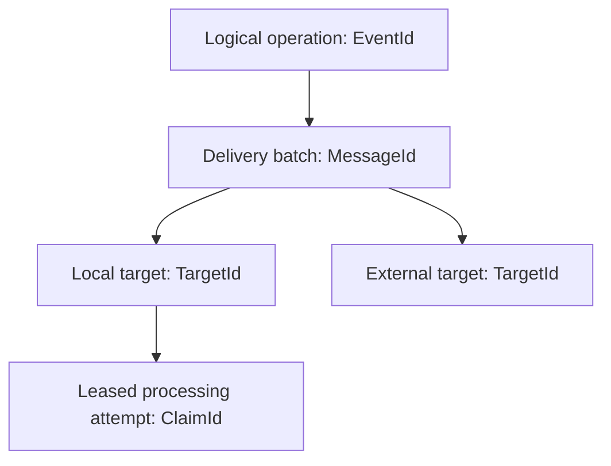

# Message identity: operations, deliveries, and attempts

## The question

Why does durable messaging need more than one identifier, and which identity should survive a retry?

A message may represent one logical fact, have several destinations, be delivered more than once, and be processed through multiple attempts. Collapsing those lifecycles into one identifier makes duplicate protection and ownership difficult to distinguish. This explanation interprets the current [identity contracts](../reference/contracts.md#identity-catalogue); it is not a record of the original authors' historical reasoning.

## Three different lifecycles

Consider a `CustomerRegistered` fact that needs a local consumer and an external publication. The conceptual layers are:

The operation is the thing that must not accidentally become a new fact when retried. A delivery identifies persisted work for that operation. A target distinguishes independent obligations. A claim identifies who currently owns one attempt, not what the operation means.

In the current EF entry model, `(MessageId, TargetId)` locates work and `(EventId, TargetId)` guards against duplicate logical work for that target. That distinction permits independently settled targets: the local consumer can complete while external publication is still retrying. It does not make the whole fan-out one distributed transaction.

## Caller-facing IDs are not interchangeable

Inbox callers supply a delivery/admission ID. An omitted logical event ID defaults to that value. This is useful when the incoming protocol has only one stable application identity, but callers with distinct delivery and logical identities can preserve both.

Outbox callers supply the logical operation ID; staging creates a new delivery batch ID. Repeating an enqueue with a replacement logical ID therefore looks like new work, not a retry of the old operation. Schedules use stable schedule identity when they later stage an outbox effect; raised domain events similarly retain their own event identity.

These are conceptual relationships, not instructions to copy an `Id` property between arbitrary message models. The exact rules are in [Inbox](../reference/inbox.md), [Outbox](../reference/outbox.md), [Domain events](../reference/domain-events.md), and [Scheduling](../reference/scheduling.md).

## Consumer identity is part of deduplication

Deduplication is not simply “have we seen this event?” It is also “has this target's obligation already been represented or completed?” Consumer and route identities are therefore operational compatibility contracts.

Changing a consumer ID can represent a different target obligation for retained admissions. Replay for a new target can be intentional; renaming an existing target without assessing retained work can instead create unexpected repeats or unresolved entries. A human-friendly name is not enough: persisted target identity must remain resolvable.

The alternative of one global completed-event flag would be simpler, but could suppress another target whose obligation has not succeeded. Per-target identities separate partial progress at the cost of more durable records and explicit target management.

## Correlation is a relationship, not a uniqueness rule

Correlation IDs group related operations. Causation identifies the delivery that led to another operation. Neither answers whether a particular target has already processed a logical event.

Many messages in the same business workflow can legitimately share correlation. Using that correlation as a deduplication key would conflate distinct operations. Conversely, a fresh correlation value cannot safely turn a duplicate logical operation into a new one. The runtime context carries relationships without being a durable workflow record; sagas maintain their own state and correlation key.

## Attempt identity is temporary

Claims change as leases expire or work is retried. Reusing the logical event ID is necessary for duplicate protection; reusing an old claim token would be wrong because it would blur processing ownership.

Database fencing can reject settlement by an obsolete owner. It cannot erase an external request that owner already sent. Identity-aware recipients and application-level idempotency can reduce repeated effects, but the sender's unique index is not proof that the recipient applied an effect only once. See [Delivery semantics](delivery-semantics.md).

## Retention limits memory

A duplicate guard based on retained records only remembers identities for as long as those records remain. Cleanup is therefore not merely a storage optimisation: it can change the time window in which old work can be recognised or replayed. The current inbox cleanup removes terminal consumer entries, not admission records; admission-level duplicate detection and replay therefore have a different retained record lifecycle from per-consumer completion.

Keeping records indefinitely increases storage and maintenance cost. Removing them requires accepting a bounded memory of prior operations or providing another recipient-side deduplication mechanism. Neither choice supplies an unlimited exactly-once guarantee. The current policies and replay behaviour are described in [Processing](../reference/processing.md) and [Inbox](../reference/inbox.md).

## Related reading

- [Contracts and identities](../reference/contracts.md): exact types and registration constraints.
- [Persistence](../reference/persistence.md): keys, uniqueness and ownership operations.
- [Transaction boundaries](transaction-boundaries.md): which changes can commit together.
- [Durable workflows](durable-workflows.md): saga and timer identities across time.
