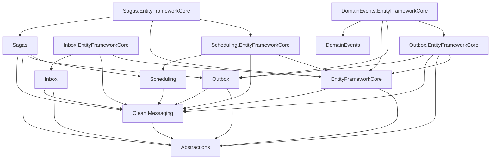
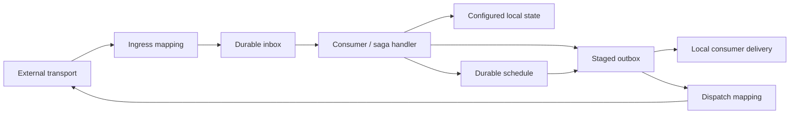

# Architecture reference

## Scope and baseline

For engineers and host developers looking up Clean.Messaging's package structure, capability relationships, and integration boundaries. This page is the system overview; exact API and lifecycle contracts are in the linked capability references.

Source reviewed on 2026-10-13. The repository contains 20 source projects targeting `net10.0`, with nullable reference types and implicit usings enabled. Eighteen explicitly declare `IsPackable=true`; Transport and Inbox.Ingress omit that property. EF Core and Microsoft.Extensions references use 10.0.11, MQTTnet uses 5.2.0.1603, and Quartz uses 4.0.1. These are project-file observations, not a tested compatibility matrix.

Clean.Messaging supplies reusable durable messaging mechanisms, not a business application. The consuming application owns message meaning, consumers, saga decisions, database configuration and executable host composition.

## On this page

- [Package map](#package-map)
- [Compile-time dependencies](#compile-time-dependencies)
- [Execution overview](#execution-overview)
- [Composition and host responsibilities](#composition-and-host-responsibilities)
- [Architectural limitations](#architectural-limitations)

## Package map

Each project is located at `src/<project-name>/<project-name>.csproj`.

| Project | Responsibility |
| --- | --- |
| `Clean.Messaging.Abstractions` | Consumer/context contracts and shared entry, dead-letter and requeue result types; no project or package dependencies. |
| `Clean.Messaging` | Contract/consumer registries, durable message serialization, consumer dispatch, runtime context, retry/failure policy, leases, work-loop primitives, metrics, and shared persistence ports. |
| `Clean.Messaging.EntityFrameworkCore` | Shared relational durable-entry mapping/store implementation, dead-letter operations, and persistence composition. |
| `Clean.Messaging.DomainEvents` | `AggregateRoot`, `IDomainEventSource`, and `RaisedEvent`; no project or package dependencies. |
| `Clean.Messaging.DomainEvents.EntityFrameworkCore` | Captures raised events from tracked entities into the transactional outbox and arranges acknowledgement after commit. |
| `Clean.Messaging.Inbox` | Durable admission API, consumer fan-out, admission/replay models, dispatch/processing contracts, management, workers, and options. |
| `Clean.Messaging.Inbox.EntityFrameworkCore` | Relational admission and entry storage, independent admission transactions, transactional consumer dispatch, mappings, and runtime registration. |
| `Clean.Messaging.Outbox` | Outgoing staging API, per-target entry creation, target/transport/delivery ports, dispatch/processing, management, workers, and options. |
| `Clean.Messaging.Outbox.EntityFrameworkCore` | Stages entries in the application's context; integrates save/transaction tracking, domain-event capture hooks, and transactional local consumer delivery. |
| `Clean.Messaging.Transport` | Provider-independent transport message/header models, payload serialization, and mapping contracts; no project or package dependencies. |
| `Clean.Messaging.Inbox.Ingress` | Maps incoming transport payloads into typed durable inbox messages. |
| `Clean.Messaging.Inbox.Ingress.Mqtt` | MQTT subscriptions, topic routing, metadata extraction, reconnect/session handling, admission, and acknowledgements. |
| `Clean.Messaging.Outbox.Dispatch` | Maps durable outgoing messages into transport payloads and envelopes. |
| `Clean.Messaging.Outbox.Dispatch.Mqtt` | MQTT target routing, connection management, message construction, and publication. |
| `Clean.Messaging.Scheduling` | Schedule identity, writer/store/delivery ports, scheduling engine, worker primitives, options, and validation. |
| `Clean.Messaging.Scheduling.EntityFrameworkCore` | Durable schedule storage, save/transaction integration, claiming, transactional execution, and cleanup. |
| `Clean.Messaging.Scheduling.Outbox` | Implements `IMessageScheduler` and delivers due message schedules into the outbox. |
| `Clean.Messaging.Scheduling.Quartz` | Replaces the scheduling wake engine with a Quartz-backed implementation. |
| `Clean.Messaging.Sagas` | Saga definitions, handlers, state serialization, transitions, outgoing effects, timers, management, and persistence ports. |
| `Clean.Messaging.Sagas.EntityFrameworkCore` | Saga storage/mapping, optimistic concurrency and conflict translation, persistence validation, and cleanup registration. |

## Compile-time dependencies

The arrows below mean **references**, not runtime message flow. EF Core, MQTTnet, and Quartz dependencies are confined to their integration projects. The provider-neutral runtime still depends on Microsoft.Extensions hosting, DI, logging, options, and configuration APIs.

Transport and scheduling integrations have these direct project references:

| Project | Direct project references |
| --- | --- |
| `Inbox.Ingress` | Inbox, Transport |
| `Inbox.Ingress.Mqtt` | Inbox.Ingress, Inbox, Transport |
| `Outbox.Dispatch` | Outbox, Transport, Clean.Messaging |
| `Outbox.Dispatch.Mqtt` | Outbox, Outbox.Dispatch, Transport, Clean.Messaging |
| `Scheduling.Outbox` | Abstractions, Clean.Messaging, Outbox, Scheduling |
| `Scheduling.Quartz` | Scheduling |

Names in this table omit the `Clean.Messaging.` prefix except for the runtime itself. Scheduling and Sagas deliberately grant friend access to their corresponding EF Core projects; project separation does not make every runtime type an independent public extension contract.

## Execution overview

| Capability | High-level path | Completion boundary | Detail |
| --- | --- | --- | --- |
| Inbox | Incoming message → durable admission → claimed consumer work | Consumer changes in the configured context and owned completion commit together. | [Inbox](inbox.md) |
| Outbox | Owning state change → staged target entries → commit → claimed delivery | Local delivery commits with consumer changes; external publication and recorded completion are separate. | [Outbox](outbox.md) |
| Domain events | Tracked event source → capture during save → commit | Pending events are acknowledged after commit; outbox delivers later. | [Domain events](domain-events.md) |
| Scheduling | Staged schedule → commit → due-work claim → selected delivery | Schedule completion commits with delivery's local changes; outbox publication follows later. | [Scheduling](scheduling.md) |
| Sagas | Correlated message/timer → handler → versioned state and staged effects | State/effects use the configured save/transaction; external delivery follows later. | [Sagas](sagas.md) |

Arrows show capability interactions, not one transaction spanning the entire graph. Local persistence and external delivery have different completion boundaries. [Persistence](persistence.md) records those contracts; [Transaction boundaries](../explanation/transaction-boundaries.md) explains their consequences.

[Contracts](contracts.md) defines identities and serialization. [Processing](processing.md) defines leases, retries, workers and observability. [Transport](transport.md) defines mapping, MQTT metadata and acknowledgements.

## Composition and host responsibilities

Each capability supplies registration APIs; [Configuration and host integration](configuration.md) records the registration map, lifetimes and validation boundaries. Exact feature overloads and provider requirements belong to the individual capability references.

Service registration, EF model configuration, and EF interceptor installation are separate integration points. The host must configure its scoped `TDbContext`, relational provider, model mappings, required interceptors, schema/migrations, contracts, consumers/routes, feature options, and hosted-service lifetime. Startup validation checks aspects of these registrations; it does not provision a database or broker.

[`PersistenceServices.EnsurePersistence<TDbContext>`](../../src/Clean.Messaging.EntityFrameworkCore/PersistenceServices.cs) permits one configured messaging context type per service collection. Inbox and outbox must use that same scoped context type. Registering multiple unrelated messaging persistence contexts in one container is not supported by this composition model.

### Integration ownership

| Responsibility | Owner |
| --- | --- |
| Registered contract serialization and consumer dispatch | Clean.Messaging runtime |
| Durable inbox/outbox processing and ownership checks | Clean.Messaging capability + configured persistence provider |
| EF `DbContext`, relational provider, mappings, and interceptor installation | Consuming host, using library integration APIs |
| Database provisioning and migrations | Consuming host |
| Domain business rules, consumer behaviour, and saga decisions | Consuming application |
| MQTT broker provisioning, connectivity, credentials, and operational configuration | Consuming host |
| External side-effect idempotency | Consuming application/integration |
| Message contract compatibility across deployments | Shared producer/consumer responsibility |

After successful registration, the library supplies the registered serialization, dispatch, and capability services and their configuration validation. Durable guarantees additionally require correct model/interceptor integration, an available database/schema, and running workers; registration alone is not proof of operational readiness. Neither registration nor broker QoS guarantees exactly-once external effects, global ordering, or compatibility with independently deployed message producers.

## Architectural limitations

| Boundary | Current limitation |
| --- | --- |
| Persistence composition | One messaging persistence-context type per service collection. |
| Provider support | Relational EF APIs are used; no tested provider compatibility matrix is supplied. |
| External effects | Publication and recorded completion are separate, so delivery can repeat. EF execution strategies can also repeat local attempts. |
| Ordering | Per-target processing does not establish global or aggregate ordering guarantees. |
| Lease fencing | Conditional settlement protects database ownership; it cannot revoke an already issued external effect. |
| Retention | Terminal-entry cleanup bounds retained per-target completion/duplicate records. Inbox admission records have a separate lifecycle and are not removed by current inbox cleanup. |
| Transaction support | Saga persistence rejects ambient transactions; outbox tracking restricts user-managed savepoints. |

This is source-derived documentation, not evidence of a successful integration run. Repository health observations are kept in [Maintenance](../maintenance.md), not treated as product architecture.

## Related documentation

- [Configuration and host integration](configuration.md): registrations, lifetimes and host obligations.
- [Message identity](../explanation/message-identity.md): operations, deliveries and attempts.
- [Delivery semantics](../explanation/delivery-semantics.md): repeat delivery and external effects.
- [Durable workflows](../explanation/durable-workflows.md): sagas, outbox effects and timers.
- [Documentation index](../README.md): all reference and explanation pages.
